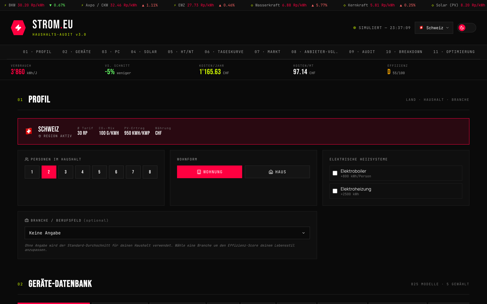

# strom-rechner

> Household electricity audit for Switzerland & the EU — consumption, cost, CO₂ and a full PDF report, all in the browser.

A React single-page app for modeling a household's electricity use. Users describe their household (country, number of people, dwelling type, appliances, PC/gaming rig, solar PV, tariff) and get back estimated consumption, costs, a CO₂ footprint, an efficiency score, tailored optimization suggestions, and a multi-page PDF audit report. All calculations run client-side — there is no backend.

The data model is built around Swiss and EU reference figures (ElCom tariffs, BFE/BFS statistics, IPCC AR6, EU-ETS, appliance values from topten.ch / energy-label.eu) and every figure in the database carries a documented source.

## Features

- **Country-aware baseline** — consumption modeled across 7 countries (CH, DE, AT, FR, IT, ES, NL) by household size, dwelling type, and electric heating/boiler use
- **Appliance database** — 825 concrete models across 22 categories (fridges, washers, TVs, routers, laptops, smartphones, and more) with multi-quantity selection per appliance
- **PC / gaming calculator** — CPU & GPU picker with idle/light/heavy usage patterns, plus fallback profiles (Office / Gaming / High-End)
- **Solar / PV simulation** — self-consumption, grid feed-in, battery, payback period, and yield per kWp by country
- **HT/NT tariff calculator** — high/low-tariff modeling and a 24-hour load-curve visualization by industry
- **Simulated market ticker** — provider prices, energy-source prices, and a provider comparison. The prices move randomly around reference values and are labeled "simuliert" in the UI; they are not real-time tariffs of the named providers
- **Efficiency dashboard** — A–G grade, personalized expected value, and CO₂ balance
- **Optimization plan** — top-5 energy hogs and a Paris climate-goal check
- **Scenarios** — save / load / delete via localStorage and export to JSON
- **PDF audit report** — multi-page report via jsPDF, including the 2010–2025 electricity-price history and a source index
- **Macroeconomic impact** — extrapolates a household's savings to a Switzerland-wide effect (TWh, CO₂, CHF) including externalities
- **Theming** — dark/light theme with persistence and a flicker-free preload

## Tech Stack

- JavaScript (ES Modules)
- React 18
- Vite 5
- lucide-react (icons)
- jsPDF (PDF export)
- CSS custom properties (theming)
- Browser localStorage (persistence)

## Getting Started

```bash
npm install
npm run dev      # starts the Vite dev server on port 5173 and opens the browser
```

Other scripts:

```bash
npm run build    # production build to dist/
npm run preview  # serve the production build locally
```

## Project Status

Work in progress. The app was developed iteratively up to v6 and is a functional, feature-rich version. It is a portfolio / prototype project — there is no automated test suite, and the consumption figures are reference estimates rather than metered measurements.

## Notes

The UI is in German (CH/EU audience). Code, comments, and data labels are predominantly German.

## Screenshots



## License

MIT, see [LICENSE](LICENSE). npm dependencies keep their own licenses.
